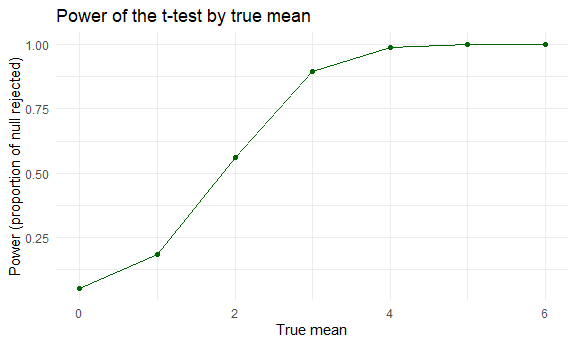
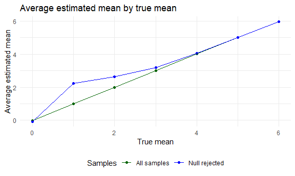

p8105_hw5_zt2397
================
Zaid Torres (zt2397)
2026-11-21

``` r
library(tidyverse)
```

    ## ── Attaching core tidyverse packages ──────────────────────── tidyverse 2.0.0 ──
    ## ✔ dplyr     1.2.1     ✔ readr     2.2.0
    ## ✔ forcats   1.0.1     ✔ stringr   1.6.0
    ## ✔ ggplot2   4.0.3     ✔ tibble    3.3.1
    ## ✔ lubridate 1.9.5     ✔ tidyr     1.3.2
    ## ✔ purrr     1.2.2     
    ## ── Conflicts ────────────────────────────────────────── tidyverse_conflicts() ──
    ## ✖ dplyr::filter() masks stats::filter()
    ## ✖ dplyr::lag()    masks stats::lag()
    ## ℹ Use the conflicted package (<http://conflicted.r-lib.org/>) to force all conflicts to become errors

``` r
knitr::opts_chunk$set(
  echo = TRUE,
  fig.width = 6,
  fig.asp = 0.6,
  out.width = "90%"
)

theme_set(theme_minimal() + theme(legend.position = "bottom"))

set.seed(1)
##This loads all of the initial information and tidyverse
```

## Problem 1 (P1)

### P1 Function for Shared Bdays

``` r
# function that gives each person a random birthday and checks if any two people share one
bday_sim = function(n_room) {
  birthdays = sample(1:365, n_room, replace = TRUE)
  repeated_bday = length(unique(birthdays)) < n_room
  repeated_bday
}

# testing the function with a small group and a large group to see if it wil work. 
bday_sim(7)
```

    ## [1] FALSE

``` r
bday_sim(67)
```

    ## [1] TRUE

### P1 Function for Shared Bdays 10,000

``` r
# runs the function 10,000 times for each group size and averages the results to get the probability
bday_sim_results = 
  expand_grid(
    group_size = 2:50,
    iter = 1:10000
  ) |> 
  mutate(
    shared_bday = map_lgl(group_size, bday_sim)
  ) |> 
  group_by(group_size) |> 
  summarize(
    prob_shared = mean(shared_bday)
  )
```

### P1 Plot for Probability of Shared Bdays

``` r
# plots the probability of a shared birthday by group size
bday_sim_results |> 
  ggplot(aes(x = group_size, y = prob_shared)) + 
  geom_point() + 
  geom_line() + 
  labs(
    title = "Probability of a shared birthday by group size",
    x = "Group size",
    y = "Probability at least two people share a birthday"
  )
```


As the group size increases, the probability of two people sharing a
birthday goes up. With small groups the probability is low, but it
passes 50% at around 23 people. By 50 people, the probability is close
to 1. This is higher than I expected, since 23 people is a lot less than
365 days. It makes sense though, because with more people there are a
lot more pairs of people who could share a birthday.

## Problem 2 (P2)

### P2 Exploring Data

``` r
# lists all the files in the data folder
list.files("data/")
```

    ##  [1] "con_01.csv" "con_02.csv" "con_03.csv" "con_04.csv" "con_05.csv"
    ##  [6] "con_06.csv" "con_07.csv" "con_08.csv" "con_09.csv" "con_10.csv"
    ## [11] "exp_01.csv" "exp_02.csv" "exp_03.csv" "exp_04.csv" "exp_05.csv"
    ## [16] "exp_06.csv" "exp_07.csv" "exp_08.csv" "exp_09.csv" "exp_10.csv"

``` r
# shows what one participant's file looks like
read_csv("data/con_01.csv") |> 
  knitr::kable()
```

| week_1 | week_2 | week_3 | week_4 | week_5 | week_6 | week_7 | week_8 |
|-------:|-------:|-------:|-------:|-------:|-------:|-------:|-------:|
|    0.2 |  -1.31 |   0.66 |   1.96 |   0.23 |   1.09 |   0.05 |   1.94 |

There are 20 files, 10 for the control arm (`con`) and 10 for the
experimental arm (`exp`). Each file has one row with 8 columns, one for
each week. The arm and subject ID are only in the file name, not in the
data itself, so I need to pull them out of the file names. The weeks are
also spread across columns, so I need to pivot the data longer to make
it tidy.

### P2 Tidying up Files

``` r
#added message = false to delte the long message printed in the knitted version. 

# reads in every file, combines them, and tidies the arm, subject ID, and weekly observations
study_df = 
  tibble(
    file_name = list.files("data/"),
    path = str_c("data/", file_name)
  ) |> 
  mutate(data = map(path, read_csv)) |> 
  unnest(data) |> 
  mutate(file_name = str_remove(file_name, ".csv")) |> 
  separate(file_name, into = c("arm", "subject_id"), sep = "_") |> 
  mutate(arm = case_match(arm, "con" ~ "control", "exp" ~ "experimental")) |> 
  pivot_longer(
    week_1:week_8,
    names_to = "week",
    names_prefix = "week_",
    values_to = "observation"
  ) |> 
  mutate(week = as.numeric(week)) |> 
  select(arm, subject_id, week, observation)
```

    ## Warning: There was 1 warning in `mutate()`.
    ## ℹ In argument: `arm = case_match(arm, "con" ~ "control", "exp" ~
    ##   "experimental")`.
    ## Caused by warning:
    ## ! `case_match()` was deprecated in dplyr 1.2.0.
    ## ℹ Please use `recode_values()` instead.

``` r
# showed me the first few point in tthe tidy data
study_df |> 
  head() |> 
  knitr::kable()
```

| arm     | subject_id | week | observation |
|:--------|:-----------|-----:|------------:|
| control | 01         |    1 |        0.20 |
| control | 01         |    2 |       -1.31 |
| control | 01         |    3 |        0.66 |
| control | 01         |    4 |        1.96 |
| control | 01         |    5 |        0.23 |
| control | 01         |    6 |        1.09 |

The final dataset has 160 rows, with one observation for each of the 20
subjects across 8 weeks.

### P2 Spagheti Plot

``` r
# spaghetti plot with one line per subject, colored by arm
study_df |> 
  ggplot(aes(x = week, y = observation, group = interaction(arm, subject_id), color = arm)) + 
  geom_line() + 
    scale_color_manual(values = c("control" = "darkgreen", "experimental" = "blue")) + ## Changed the graph color
  labs(
    title = "Observations over time by subject",
    x = "Week",
    y = "Observation",
    color = "Arm"
  )
```


Both groups start out at about the same level in week 1. Over the 8
weeks, the experimental group’s observations go up steadily, while the
control group stays pretty flat around 0 to 2. By week 8, almost every
subject in the experimental group is higher than every subject in the
control group, so it looks like the experimental arm had an effect over
time.

## Problem 3 (P3)

In this problem I run a simulation to look at power in a one-sample
t-test. I fix the sample size at 30 and the standard deviation at 5, and
change the true mean from 0 to 6.

### P3 Simulation Function

``` r
# function that simulates one dataset and saves the estimated mean and p-value from a t-test
sim_power = function(mu, n = 30, sigma = 5) {
  
  x = rnorm(n, mean = mu, sd = sigma)
  
  t.test(x, mu = 0) |> 
    broom::tidy()
  
}

# testing the function once
sim_power(mu = 0)
```

    ## # A tibble: 1 × 8
    ##   estimate statistic p.value parameter conf.low conf.high method     alternative
    ##      <dbl>     <dbl>   <dbl>     <dbl>    <dbl>     <dbl> <chr>      <chr>      
    ## 1   -0.354    -0.356   0.724        29    -2.39      1.68 One Sampl… two.sided

These numbers change every time the function runs because `rnorm()`
draws a new random sample of 30 values each time. Since every sample is
a little different, the estimated mean and p-value will be a little
different too, even though the true mean stays the same. This is why we
repeat the simulation 5,000 times instead of only running it once.

### P3 Simulation 5,000 datasets

``` r
# runs the function 5,000 times for each true mean from 0 to 6
power_sim_results = 
  expand_grid(
    true_mu = 0:6,
    iter = 1:5000
  ) |> 
  mutate(
    estimate_df = map(true_mu, sim_power)
  ) |> 
  unnest(estimate_df)
```

### P3 Power Plot

``` r
# proportion of times the null was rejected for each true mean
power_sim_results |> 
  group_by(true_mu) |> 
  summarize(
    power = mean(p.value < 0.05)
  ) |> 
  ggplot(aes(x = true_mu, y = power)) + 
  geom_point(color = "darkgreen") + 
  geom_line(color = "darkgreen") + 
  labs(
    title = "Power of the t-test by true mean",
    x = "True mean",
    y = "Power (proportion of null rejected)"
  )
```



As the true mean (effect size) gets bigger, the power goes up. When the
true mean is 0, the null is only rejected about 5% of the time, which
makes sense since that is the alpha level. Power increases quickly
between 1 and 3, and by a true mean of about 4 the test rejects the null
almost every time. So bigger effects are a lot easier to detect.

### P3 Average Estimate Plot

``` r
# average estimate across all samples and only in samples where the null was rejected
power_sim_results |> 
  group_by(true_mu) |> 
  summarize(
    all_samples = mean(estimate),
    null_rejected = mean(estimate[p.value < 0.05])
  ) |> 
  pivot_longer(
    all_samples:null_rejected,
    names_to = "samples",
    values_to = "avg_estimate"
  ) |> 
  ggplot(aes(x = true_mu, y = avg_estimate, color = samples)) + 
  geom_point() + 
  geom_line() + 
  scale_color_manual(
    values = c("all_samples" = "darkgreen", "null_rejected" = "blue"),
    labels = c("All samples", "Null rejected")
  ) + 
  labs(
    title = "Average estimated mean by true mean",
    x = "True mean",
    y = "Average estimated mean",
    color = "Samples"
  )
```



Across all samples, the average estimate is very close to the true mean.
In the samples where the null was rejected, the average estimate is too
high when the true mean is small (around 1 to 3). This is because when
power is low, only the samples that happened to get a large estimate are
significant, so those samples overestimate the true mean. When the true
mean is 4 or higher, almost every sample rejects the null, so the
average for the rejected samples ends up close to the true mean too.
